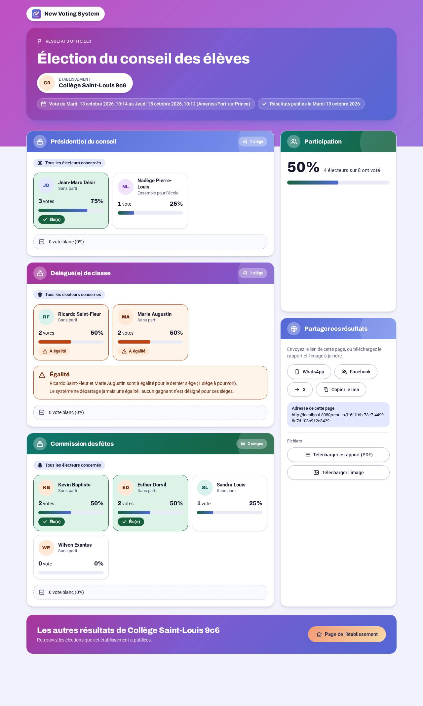

&nbsp;
<p align="center">
  <a href="https://github.com/jun101/VotingSystem">
    
  </a>
</p>
<h3 align="center">Online elections that an institution can run alone</h3>
<p align="center">Register, set up the ballots, load the voters, hand out the codes on paper or by email,<br>
    vote in under a minute on a cheap phone, and publish the results. Built first for schools in Haiti.</p>
<hr />
<p align="center">
    <a href="https://vote.fleuridor.com">Live demo</a> |
    <a href="https://github.com/jun101/VotingSystem/releases">Releases</a> |
    <a href="docs/ops/installation-guide.md">Install guides</a> |
    <a href="docs/SPEC.md">Specification</a> |
    <a href="docs/design/architecture.md">Architecture</a> |
    <a href="docs/api/README.md">API</a> |
    <a href="#development">Develop</a> |
    <a href="https://github.com/jun101/VotingSystem/issues">Issues</a>
    <br /><br />
    <a href="https://github.com/jun101/VotingSystem/releases">
        
    </a>
    <a href="https://github.com/jun101/VotingSystem/actions/workflows/ci.yml">
        
    </a>
    <a href="https://github.com/jun101/VotingSystem/actions/workflows/security-audit.yml">
        
    </a>
    <a href="LICENSE">
        
    </a>
    <a href="https://github.com/jun101/VotingSystem/commits">
        
    </a>
    <br />
    
    
    
    
    
    
    
    
    
</p>

&nbsp;

<br>

<p align="center">
    
    &nbsp;&nbsp;
    
</p>

<br>

&nbsp;

---

&nbsp;

**Voting System** is a web platform for institutions (schools first) that want to run their own elections without technical staff. It is multi-tenant, French and English, mobile-first, and designed so that nobody can find out how a given person voted through the application, not the institution and not a platform administrator.

> **Status:** pre-release, already running a real server. It was installed and tested on Debian 12 and 13, Ubuntu 24.04 and 26.04, Windows 11, and as the online edition on a VPS with a domain and HTTPS. The [live demo](https://vote.fleuridor.com) runs the latest release; the release badge above shows its version. See [Project status](#project-status).

&nbsp;

# How an Election Works

<p align="center">
    
</p>

1. **Set up.** Create the election with its dates and time zone, one or more ballots (positions to fill), optional parties, and candidates with photos.
2. **Load the voters.** Import a CSV or Excel file, or add voters by hand, and put them in groups such as "4th grade".
3. **Send the codes.** Each voter gets a personal access code, on a printable **PDF of slips with QR codes**, by **email**, or in a **file for your own channel**. Paper costs nothing.
4. **Vote.** The voter opens the link or scans the QR code, confirms who they are, picks their candidates on each ballot, reviews, and confirms. One vote, final.
5. **Results.** Nobody sees a count before the election closes. Then the institution reads the results, downloads the official PDF report, and publishes a public page that is easy to share.

&nbsp;

# Features

| Area | What it does |
|---|---|
| **Institutions** | Self-service sign-up with email verification, public profile page, institution owners and managers, invitations by email, optional two-factor authentication (TOTP), a log of every important action |
| **Elections** | Draft, scheduled, open, closed, published, archived. Opens and closes by itself at the set time (the scheduler does not depend on anyone being signed in). Can be extended while open, closed early, duplicated, and archived |
| **Ballots** | Several ballots per election, several seats per ballot, optional blank vote, candidate order manual or shuffled per voter. A ballot is **general** (every voter) or **group** (only the chosen groups): a school can elect a president for everyone and a delegate per class in one election |
| **Voters** | CSV and XLSX import with a check screen before anything is saved, groups, add and edit while the election is open, reissue a lost code |
| **Credentials** | Slips as PDF with QR code, emails (with a count and a confirmation before sending), or a CSV/XLSX file. The personal link carries the code after a `#`, so it never reaches server or proxy logs |
| **Voting** | Countdown before the start, identity confirmation, one ballot after another, a review screen, atomic submission, a 15-minute session, and a reset after submitting so the next person can use the same shared device. Works from 320 px wide, French or English |
| **Results** | Live turnout while open (by group too), exact results after closing, ties **reported and never broken**, a consistency check (recorded votes equal voters marked as voted), an official PDF report, a shareable image, and a **second round** drafted from a tie |
| **Publication** | A public results page with a stable address and social sharing (WhatsApp, Facebook, X, copy link), plus a public institution page listing published elections |
| **Platform** | Platform administrators list, suspend and reactivate institutions and see platform statistics. They have no screen that shows votes, codes or voter data |

<p align="center">
    
</p>

&nbsp;

# Ballot Secrecy and Integrity

This is the part the whole design is built around.

<p align="center">
    
</p>

- **Two records, no link.** "This voter has voted" and "one vote for this candidate" are stored in different places, with no shared identifier, no sequence number and no timestamp on the vote.
- **One transaction, one vote.** A vote is written in a single transaction, with a row lock on the voter and a database unique constraint on (election, voter). A test submits the same vote many times at once and checks that exactly one is recorded.
- **The server's clock decides.** A vote needs the election to be open **and** the server time to be between start and end.
- **No count before closing.** Not for the institution, not for a platform admin: until the election is closed, only turnout is shown.
- **No breakdown by group** of a general ballot, because a small group would reveal individual votes. A group ballot covering fewer than 5 voters shows a warning.
- **Eligibility is checked on the server.** A submission with a ballot the voter may not vote on, or missing one they may, is rejected as a whole.
- **An encrypted audit record per vote.** The vote, the voter and the exact time are sealed with a **public key**. The server holds only that key: it can write the record and can never read it. The private key stays with the platform operator, never on the server, in the database, in the repository or in a backup. No screen, endpoint, export or log gives access to these records, and results never read them.
- **No database id ever leaves the server.** URLs, bodies, cookies, file names, emails and PDFs only carry random UUIDs.
- **Tenant isolation.** Every record belongs to one institution; another institution's record answers 404, and automated tests cover it.

The full list of requirements, with stable IDs (`FR-SEC-01`, `NFR-SEC-08`, and so on), is in [docs/SPEC.md](docs/SPEC.md).

&nbsp;

# Quickstart Install

Three installers, one per situation. Each has a **step-by-step guide** in French and English, written for a person with basic computer skills.

| Situation | Installer | Needs | Email | Guide |
|---|---|---|---|---|
| A Linux server in the institution, no internet | `install.sh` (school edition, native, no Docker) | Debian 12 or 13, Ubuntu 24.04 or 26.04, x86_64, 4 GB memory, 5 GB free, systemd | No: the installer creates the accounts | [Linux guide](docs/guides/install-school-linux.md) |
| A Windows computer in the institution | `install.ps1` (school edition, native, no Docker or WSL) | Windows 10 1809 or later, Windows 11, Windows Server 2019 or later, 64-bit, 4 GB, 5 GB free | No | [Windows guide](docs/guides/install-school-windows.md) |
| An online server with a domain name | `install-online.sh` (online edition, Docker, automatic HTTPS) | Debian or Ubuntu with Docker (installed by the script if missing), ports 80 and 443, a domain name | Yes (SMTP) | [Online (VPS) guide](docs/guides/install-online-vps.md) |

Example for the Linux school edition. **Replace `xxx` with the version of the latest release**: check the [releases page](https://github.com/jun101/VotingSystem/releases) and use the number after the `v` of the newest tag. Download the archive and its checksum, check the sum, and unpack:

```
$ wget -q https://github.com/jun101/VotingSystem/releases/download/vxxx/votesystem-xxx-linux-x86_64.tar.gz{,.sha256}
$ sha256sum -c votesystem-xxx-linux-x86_64.tar.gz.sha256
$ tar -xzf votesystem-xxx-linux-x86_64.tar.gz && cd votesystem-xxx-linux-x86_64
```

&nbsp;

Run a dry run first: it shows the checks and the plan and changes nothing. Then install:

```
$ sudo ./installers/install.sh --dry-run --lang en --school "Saint-Louis College" --owner-email principal@school.local --admin-email admin@school.local
$ sudo ./installers/install.sh --lang en --school "Saint-Louis College" --owner-email principal@school.local --admin-email admin@school.local
```

&nbsp;

The installer writes two files. Read this part twice:

- **the accounts** (`votesystem-identifiants.txt`, temporary passwords), changed at first sign-in;
- **the audit private key** (`votesystem-cle-audit-A-EMPORTER.txt`). Copy it to a USB key, then **delete it from the machine**.

Then open the site address, change each temporary password, and turn on two-factor authentication for the owner and the administrator. The installer also offers to open the site's one port in the firewall and removes the rule on uninstall.

<details>
<summary><b>All the installer options and what each one does</b></summary>

&nbsp;

- **Windows:** `install.ps1` from an administrator PowerShell, with `-DryRun` for the plan only, `-Lang`, `-School`, `-OwnerEmail` and `-AdminEmail` as above.
- **Online edition:** `sudo ./install-online.sh --domain vote.example.org --admin-email admin@example.org` (also `--dry-run`), automatic HTTPS, and `--behind-proxy --proxy-network npm_network` to run behind an existing reverse proxy such as Nginx Proxy Manager. See [docs/ops/production-vps.md](docs/ops/production-vps.md).
- `--yes` accepts the proposed values. The site uses port 80 by default, otherwise the next free one.
- **Update:** unpack the latest release (`xxx` is its number, as above) and run `install.sh update` (`install.ps1 update`; online: `install-online.sh update --archive FILE`, or `votectl update --version xxx`). It makes a backup, runs the migrations, and goes back to the previous version by itself if anything fails.
- **Uninstall:** `install.sh uninstall` keeps the data unless you give `--purge-data`.

The same guide is in the application for the signed-in owner and platform admin, under "Guide d'utilisation", "Installation".

</details>

&nbsp;

# Operating It

The `votectl` command manages an installation (on Windows, the same command in an administrator PowerShell):

```
$ votectl status | version | logs | backup | restore | update
$ votectl user list | user reset-password | owner create | admin create | 2fa reset | mail test
```

&nbsp;

- **Backups.** One a night on the school editions (the last 14 kept), and a cron line for the online edition. A backup holds the whole database and the pictures, never the audit private key. Copy the archives to an external disk: a backup that stays on the same disk is not a backup. Procedure and rehearsal: [docs/ops/backup-restore.md](docs/ops/backup-restore.md).
- **Restore.** `votectl restore <archive>` checks the checksum, stops the application, loads the data, restarts and migrates.
- **Rollback.** An update that fails returns to the previous version by itself.
- **Logs.** One JSON line per record, with the `request_id` that an error answer gives as `reference`. Logs never contain codes, passwords or votes.

&nbsp;

# Development

You need **Docker** with the Compose plugin. Nothing else: PHP, Composer and Node all run in containers.

```
$ make setup
```

&nbsp;

`make setup` creates `.env`, generates the secrets that are missing (it never replaces a value already set), builds the images, installs the dependencies, runs the migrations and gives the application's database account its rights table by table. Then:

```
$ make up
```

&nbsp;

Open **http://localhost:8080**: the home page shows the state of the API, the database and Redis. Emails sent in development are caught by Mailpit at http://localhost:8025. Change the port with `HTTP_PORT` in `.env`.

| Command | What it does |
|---|---|
| `make up` / `make down` | start the whole system / stop it |
| `make restart-api` | reload the API workers after editing PHP (Octane keeps the code in memory) |
| `make test` | every API suite and the web unit tests |
| `make e2e` | browser tests (Playwright) against the running stack |
| `make lint` | Pint, PHPStan, ESLint, Prettier and `tsc` |
| `make generate` | regenerate `docs/api/openapi.json` and `web/src/lib/api/schema.d.ts` |
| `make generate-check` | fail if either generated file differs from what is committed |
| `make build` | build the production web image |
| `make audit` | check every dependency, dev tools included, for known vulnerabilities |
| `make security` | local security scans: secrets, static analysis, images, ZAP (not part of CI) |
| `make check` | **everything CI runs** |

<details>
<summary><b>Good to know before you start</b></summary>

&nbsp;

- **Development and production values.** `.env.example` holds the development values (`APP_ENV=local`, `APP_DEBUG=true`). If a variable is missing from `.env`, `compose.yaml` falls back to production values, never to development ones.
- **A database volume that already exists keeps its accounts and passwords.** If you change `DB_DATABASE`, `DB_PASSWORD` or `DB_MIGRATOR_PASSWORD` after the first start, the database no longer opens. Run `docker compose down -v` (development data is lost) and `make setup` again.
- **Two database accounts.** The serving containers (`api`, `queue`, `scheduler`) hold the `app` account. It reads every table and writes only where `php artisan db:grant-app` gives it the right. Tables that only receive new rows (such as the vote tables) get `INSERT` and nothing else. After adding a migration, run `make setup` (or `docker compose run --rm migrate`).
- **A second clone on the same machine.** `make setup` writes the development audit private key to `~/.config/new-voting-system/vote-audit-dev.private`, outside the repository. A second clone stops until you copy the `VOTE_AUDIT_PUBLIC_KEY` line into its `.env`, or point `VOTE_AUDIT_PRIVATE_KEY_FILE` somewhere else.
- **Browser tests** run in a container on the Compose network and reach the proxy as `http://proxy:8080`.
- **The API stays in memory** (Octane). Nothing that belongs to one request may live in a singleton or a static property.

</details>

&nbsp;

# Architecture

<p align="center">
    
</p>

Everything is served from **one origin**: no cross-origin setup, first-party cookies, and a strict Content-Security-Policy. The API never gets a hostname of its own.

| Layer | Choice |
|---|---|
| API | Laravel 13, PHP 8.5, Laravel Octane on FrankenPHP, REST + JSON, OpenAPI file generated from the code |
| Web | Next.js 16 (App Router), React 19, TypeScript 5.9, Tailwind CSS 4, typed client generated from the OpenAPI file |
| Data | MariaDB, Redis (sessions, cache, queues, rate limits) |
| Documents | PDF with QR codes (TCPDF), spreadsheets without formula evaluation (OpenSpout), TOTP two-factor |
| Proxy | Caddy: automatic HTTPS, security headers, routing by path |
| Runtime | Docker Compose: `proxy`, `api`, `queue`, `scheduler`, `web`, `db`, `redis`, and Mailpit in development |
| Quality | Pest, PHPStan (Larastan), Pint, Vitest, Playwright, ESLint, Prettier |

Read more: [architecture](docs/design/architecture.md), [database](docs/design/database.md), [front end](docs/design/frontend.md), [email](docs/design/email.md).

&nbsp;

# Quality and Security

| Area | Detail |
|---|---|
| **Tests** | More than 2,500 API tests, nearly 700 web unit tests and more than 900 browser tests at the last full run |
| **CI** | Every pull request into `main` runs lint (Pint, PHPStan, ESLint, Prettier, `tsc`), the API tests against MariaDB and Redis, the web unit tests, a check that the OpenAPI file and TypeScript types are up to date, the production build, the dependency audit and the browser tests against the running stack |
| **Weekly audit** | A scheduled workflow runs `composer audit` and `npm audit` every Monday, because new advisories land between pull requests |
| **Security scans** | `make security` runs gitleaks (secrets and history), Semgrep (static analysis), Trivy (dependencies, Dockerfiles and images) and an OWASP ZAP baseline scan |
| **Reference** | OWASP ASVS level 2 for the admin area and the voting flow. Argon2id passwords, keyed-hash credentials, HTTPS and HSTS, CSRF protection, rate limiting on sign-in, password reset, code entry and uploads, uploads validated by content |
| **Accessibility** | WCAG 2.1 AA targeted for the voting flow and the public results page |

**Load test.** `tools/loadtest/vote_load.py` plays what an organiser and voters really do, through the real flow, then closes the election and checks every tally. On production images, on a laptop, from a single address:

| Run | Votes accepted | Errors | Wall time | Results |
|---|---|---|---|---|
| 500 voters spread over 60 s | 500 of 500 | 0 | 59.8 s | exact tallies, check ok |
| 500 voters all at once | 500 of 500 | 0 | 3.1 s | check ok |
| 1,000 voters spread over 60 s | 1,000 of 1,000 | 0 | 60.0 s | check ok |

Details and what the test found: [docs/ops/load-test.md](docs/ops/load-test.md).

&nbsp;

# Documentation

| Folder or file | What is in it |
|---|---|
| [docs/SPEC.md](docs/SPEC.md) | The requirements, with stable IDs |
| [docs/design/](docs/design) | Architecture, database, front end, email, mockups |
| [docs/api/](docs/api/README.md) | API conventions, one file per endpoint, and the generated `openapi.json` |
| [docs/guides/](docs/guides) | Step-by-step install guides for the three editions |
| [docs/ops/](docs/ops) | Installation, backup and restore, production VPS, load test, test report |
| [docs/slices/](docs/slices) | One brief per slice of the work |
| `api/` and `web/` | The Laravel API, and the Next.js application with its browser tests |
| `installers/` | Linux, Windows and online installers, the bundle builders and `votectl` |
| `docker/` and `tools/` | Dockerfiles, proxy and database set-up, load test and security scans |

&nbsp;

# Project Status

The project is in pre-release: check the [releases page](https://github.com/jun101/VotingSystem/releases) for the latest release candidate. Every slice of the plan is built and merged: the voting flow, opening and closing, turnout, results, publication, the audit log, platform administration and security hardening, plus the three installers. Releases are built by a workflow that publishes the archives and their checksums.

Not done yet, in the open: the fresh-install test of the latest release on a clean machine, and the `v1.0.0` tag.

&nbsp;


# Getting Help

Bugs and questions are welcome in [GitHub Issues](https://github.com/jun101/VotingSystem/issues). For a **security problem**, please do not open a public issue: report it privately from the repository's **Security** tab ([Report a vulnerability](https://github.com/jun101/VotingSystem/security/advisories/new)). See [SECURITY.md](SECURITY.md).

&nbsp;


# Copyright & License

Copyright (c) 2026 Josué Junior Fleuridor. Released under the [PolyForm Strict License 1.0.0](LICENSE).

In plain words: you may **read the code and run it for non-commercial purposes**, including use by schools, universities, charities, public bodies and for personal study, research and testing. You may **not** distribute it, or change it or build new works from it. For any other use, ask the author first. This is a source-available license, not an open-source one.
